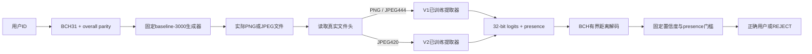

# ECC-Protected WOUAF · V3 最终研究版本

从图像恢复 WOUAF 用户指纹，结合 **BCH 纠错、整体 parity 与置信度拒绝**，在证据不足时输出 `REJECT`。主要目标是减少错误归属，并在 JPEG420 压缩后尽可能恢复正确用户。

**默认入口已经是训练好的 V3，无须先训练。** 完整预训练 Release ZIP 包含两份真实权重；从 GitHub clone 时先运行 `python scripts/download_pretrained.py` 和 `python scripts/download_support.py` 下载同一权重。下载器按原始 SHA256 校验；缺失或校验不符会报错，不会回退到随机模型。训练入口单独放在 `training/`，V1/V2 可以显式选择作对照。

V3 是**按真实文件头选择两份已训练提取器的系统**：PNG / JPEG444 使用 V1，JPEG420 使用 V2 专家。每张图只前向一次，不融合两次预测，也没有一个被误称为“全面提升”的新单模型。曾尝试的单模型 V3 训练与权重融合未通过全部保留要求，过程记录与最终系统分开放置。

## 1. 版本与适用范围

| 版本 | 已训练组件 | 推理方式 | 发布角色 |
|---|---|---|---|
| V1 | 负样本感知双头提取器，2400 步 | 所有文件固定使用 V1 | 平衡基线、对照 |
| V2 | 从 V1 追加 2400 步，选择 extra800 | 所有文件固定使用 V2 | JPEG420 专家、对照 |
| **V3，默认** | 保留 V1 和 V2 两份原权重 | 实际 JPEG 4:2:0 → V2；其余 → V1 | **最终研究系统** |

水印生成器始终固定在 **baseline-3000**。本轮整理没有训练、调门槛或覆盖旧版本。主码是 BCH(31,11)+P：2048 用户、t=5；容量对照 BCH(31,16)+P：65536 用户、t=3。最初选 k16，真实图像和误归属实验后将 k11 作为默认。

已量化范围为 512×512 RGB、原生 PNG、Pillow JPEG Q90 4:4:4 / 4:2:0。按文件内容识别，扩展名不参与路由；JPEG420 改名为 `.png` 仍走专家。**如果真的解码后转存为 PNG，旧 JPEG 色度采样历史无法由新文件头恢复**，此时走 V1。JPEG422、灰度 JPEG 和其他容器走 V1，但没有相同范围的效果验证。不静默缩放图像。

## 2. 项目结构

```text
ecc-protected-wouaf-v3/
  README.md / README.en.md              总说明与英文快速入口
  infer.py / encode.py / evaluate.py    默认预训练 V3、指纹编码、原生文件评估
  ecc_wouaf/                           V3路由、双头网络、BCH、拒绝规则
  configs/pretrained.json              默认V3系统配置
  configs/versions/v1.json, v2.json     独立对照配置、冻结门槛、权重校验
  models/v1_negative_aware_2400.pth     实际V1已训练权重
  models/v2_jpeg420_expert_extra800.pth 实际V2已训练权重
  ecc/                                原生成矩阵与syndrome表
  environment/locked/                 完整软件清单、恢复器、隔离启动器
  training/                           显式自行训练，与默认推理分开
  training/research_reference/         历史研究代码，已标明路径适配边界
  generation/                         固定生成器、prompt采样、latent解码
  analysis/recompute.py               无需GPU重算保存预测的统计
  demo/                               小量真实PNG/JPEG、GT及参考输出
  reports/v1, v2, v3, independent/     训练、选点、回归、独立验证证据
  docs/                               环境、流程历史、训练、结果、GitHub说明
  scripts/                            恢复资产、验证预训练、文件完整性
  00_PRETRAINED_V3_DEMO.ipynb          干净的预训练演示notebook
  asset_manifest.json / SHA256SUMS.txt 大资产清单与项目文件校验
```

Drive 发布目录还保存 `offline_assets/`：冻结环境、完整 baseline 生成器、训练初始化、训练图像、原评估数据、原 5000 latents，以及新独立验证的源 PNG / 实际 JPEG / 原始自然照片 / 新 latents。大资产独立分发，不放入普通 Git 历史；主 ZIP 包含实际训练权重。旧版本和原始研究目录仍独立保留。

## 3. 快速开始：恢复软件后直接推理

GitHub clone 后先运行 `python scripts/download_pretrained.py`；也可以下载包含实际权重的完整预训练 Release ZIP。完整冻结环境与数据资产保留在 [Drive 发布目录](https://drive.google.com/drive/u/0/folders/1CTqCSbCHS480Hz6xRbp17KvvmTad3_cq) 的 `offline_assets/`，访问沿用该目录现有权限；这些大资产不包含在普通 Git clone 或主项目 ZIP 内。严格环境复现需要先获得这些资产。

随包 `00_PRETRAINED_V3_DEMO.ipynb` 是基于 Drive 原归档恢复的演示；它会挂载 Drive，按原始项目 ZIP 恢复。以下终端命令均从解压后的项目根目录执行；Colab 中由 notebook 的 Python `subprocess` 启动，不用把 Bash 粘进 Python 单元格。

```bash
# clone 后下载已训练模型；完整预训练ZIP已含权重，此命令只校验。
python scripts/download_pretrained.py

# ASSETS 指向Drive发布目录中已下载/挂载的 offline_assets。
python scripts/materialize_assets.py --asset-root "$ASSETS" --id frozen_environment
python scripts/restore_environment.py
python scripts/run_locked.py --check
python scripts/verify_files.py

# 验证随包真实文件与保存参考输出；不会训练。
python scripts/run_locked.py scripts/verify_pretrained.py --output outputs/demo_verification.json

# 不加 --version 即加载训练好的 V3。--image 可用 demo/manifest.json 中的 image 路径。
python scripts/run_locked.py infer.py --image demo/images/png8_control/positive_k11/10000000.png --output outputs/prediction.json

# 显式对照；输入为同一个已编码文件，不在此入口额外JPEG压缩。
python scripts/run_locked.py infer.py --version v1 --image YOUR_512_IMAGE.jpg --code 11
python scripts/run_locked.py infer.py --version v2 --image YOUR_512_IMAGE.jpg --code 11
python scripts/run_locked.py infer.py --image YOUR_512_IMAGE.jpg --code 16
```

Python API 也默认 V3：

```python
from ecc_wouaf import Predictor
system = Predictor()  # 必须在冻结解释器中运行。
result = system.predict("YOUR_512_IMAGE.jpg", k=11)
# 字节API保留真实容器信息；不要先转成RGB tensor再期待JPEG格式路由。
result = system.predict_encoded(open("YOUR_512_IMAGE.jpg", "rb").read(), k=11)
```

JSON 包括 `ACCEPT/REJECT`、接受时的 `user_id`、拒绝原因、实际容器/采样、所选分支、模型 SHA256、32-bit `pred_bits`、logits、probabilities、presence logit、BCH 距离及规则。**REJECT 时 `user_id=null`，不能把内部候选当成有效归属。** 普通输入没有 GT；GT 只在编码与带标签评估清单中提供。

## 4. 环境必须保持一致

| 项目 | 冻结配置 |
|---|---|
| Python | 3.10.21 |
| PyTorch / torchvision | 1.12.1+cu116 / 0.13.1+cu116 |
| NumPy / diffusers / transformers | 1.23.5 / 0.12.1 / 4.26.0 |
| Pillow / SciPy | 12.3.0 / 1.15.3 |
| 参考GPU / 驱动 | NVIDIA A100-SXM4-80GB / 580.82.07 |
| 解释器固定前缀 | `/content/strict_wouaf_restore/env` |
| 提取器推理/训练 | float32；TF32 off；cudnn benchmark off；deterministic True；threads 2 |
| baseline生成/解码 | 同一软件栈，但 cudnn deterministic False，忠实保留原生成设置 |

完整 **91 个 distributions、23 个 conda native builds** 与文件清单随包提供。用归档恢复，不运行 `pip install -U`；`requirements.reference.txt` 供核对，不能保证只靠 pip 重建相同二进制。默认 Colab Python 负责挂载/解压/启动，科学计算在隔离的冻结解释器内。

仓库目录可以换位置；固定的是环境前缀。严格模式检查 GPU、驱动及包清单，改变硬件后需另做回归。`infer.py --allow-unvalidated-runtime --device cpu` 是显式非参考模式，不能据此声称数值严格复现。该归档锁定已验证软件栈，不能追溯证明早期未保存 hash 的所有历史二进制。恢复细节与已知环境边界见 [ENVIRONMENT.md](docs/ENVIRONMENT.md)。

## 5. 从用户到图像再到归属



编码命令：`python scripts/run_locked.py encode.py --code 11 --user-id 123`。用户 ID 为 0…2^k−1；BCH 前 k 位为用户消息，最后一位是前31位整体 parity。提取沿用 `sigmoid(logits)>0.5`，再按32位距离、码半径和门槛判定。所有 2^k 用户都允许，没有 GT 白名单。

两版本共用冻结门槛：k11 的平均候选 bit log-likelihood ≥ −0.32913199046823777；k16 ≥ −0.1908652798183046；presence logit 均 ≥ 0。parity、BCH、bit门槛和presence分别减少不同类型的失败，不能把 bit accuracy 当作 exact user recovery。

完整历史流程见 [PIPELINE_HISTORY.md](docs/PIPELINE_HISTORY.md)：baseline3000固定 → 真实逐图bits导出与错误分布 → BCH真实码字评估 → 实际JPEG诊断 → 提取器鲁棒性改进 → presence负样本训练V1 → 完整码字目标V2 → 单模型V3保留检查失败 → 最终文件格式路由V3 → 锁定新独立数据验证。初期 synthetic ECC 工作只保留历史，不在最终流程继续运行。

## 6. 最终独立验证：主要结果

V3 和规则在新数据产生前固定。64个基础场景 × 4种光照 × 4种构图形成1024个新prompt/seed单元；新latent分别生成 k11/k16 水印图和同源无水印图，再加1024张排除历史ID/hash的COCO自然图。共4096源图、12288实际编码视图。下表每格分母是 **1024张对应码正样本**。

| BCH+P | 条件 | V1正确恢复 | 最终V3正确恢复 | 差值百分点 [95%场景块配对区间] |
|---|---|---:|---:|---:|
| (31,11) | PNG | 923/1024，90.14% | 923/1024，90.14% | 0 |
| (31,11) | JPEG444 Q90 | 897/1024，87.60% | 897/1024，87.60% | 0 |
| (31,11) | JPEG420 Q90 | 759/1024，74.12% | **787/1024，76.86%** | **+2.73 [1.37,4.10]** |
| (31,16) | PNG | 693/1024，67.68% | 693/1024，67.68% | 0 |
| (31,16) | JPEG444 Q90 | 577/1024，56.35% | 577/1024，56.35% | 0 |
| (31,16) | JPEG420 Q90 | 342/1024，33.40% | **383/1024，37.40%** | **+4.00 [2.64,5.47]** |

PNG/444 的 V1/V3 logits、bits与归属决定逐样本完全一致。两码、三条件及两类负样本中，本次 V1/V3 **观察到的错误归属均为0**；这不等于真实风险为0。k11 JPEG420仍有237/1024拒绝。JPEG420配对：k11新增正确42、丢失14；k16新增47、丢失6。CI按64场景整块重采样10000次，主终点预先固定为k11 JPEG420。

1024新latent与原5000张latent哈希无重叠；新图没有用于训练、选点、校准。k11容量有限，测试用户ID与旧测试可复用，不声称完全未见身份；也不声称与基础模型预训练语料不重叠。不同格式/同场景不能当作独立样本相加扩大样本量。

## 7. V1/V2/V3 对照与研究记录

以下是**较早、已经观察过的4096源图回归队列**，不是上一节的新独立队列。每格1024正样本。

| 版本 | k | PNG正确数 | JPEG444正确数 | JPEG420正确数 | 三条件错误归属总数 |
|---|---:|---:|---:|---:|---:|
| V1 | 11 | 930 | 897 | 755 | 0 |
| V2 | 11 | 915 | 887 | 787 | 0 |
| **V3** | 11 | **930** | **897** | **787** | 0 |
| V1 | 16 | 729 | 597 | 333 | 1 |
| V2 | 16 | 711 | 589 | 393 | 1 |
| **V3** | 16 | **729** | **597** | **393** | 1 |

V2改善420但损失PNG/444，故作为专家。V3保留两者优势，并用新独立内容验证。两队列难度不同，不能用跨队列百分比直接计算提升。完整训练history、selection、固定policy检查、失败尝试、逐样本GT/logits/bits、BER、Hamming分布、per-bit频率和相关矩阵见 `reports/` 和 [RESULTS.md](docs/RESULTS.md)。

历史基线指标 NGC93.42%、TRAIN TYPE VAL93.40%、CLIPScore0.37329 属于原baseline3000协议；不是本表的exact用户恢复率。本发布只改提取/判定系统，不重新评估所有图像质量指标，不能把这些基线指标冒称为本轮新测。历史“跑5000”是评估样本数，不是训练5000步。

## 8. 复现结果：由轻到重

**A. 核对文件和演示输出**：执行第3节的 `verify_files.py` 和 `verify_pretrained.py`。不训练。

**B. 从随包逐样本预测重算完整统计**：不用重新生成图像或前向网络；BCH决策也会重算。

```bash
python scripts/run_locked.py analysis/recompute.py --out outputs/recomputed_independent
```

会输出两组码、三条件的正确/拒绝/错误归属、同一bootstrap CI、真实BER、P(E=k)、每bit错误频率和相关矩阵。`reports/release_validation.json` 记录与原结果逐项核对的结果。

**C. 重新读取全部独立测试原生图像**：

```bash
python scripts/materialize_assets.py --asset-root "$ASSETS" --id independent_source_pngs_positive_k11 independent_source_pngs_positive_k16 independent_source_pngs_generated_negative independent_source_pngs_natural_negative independent_encoded_jpeg_q90_444 independent_encoded_jpeg_q90_420
python scripts/prepare_independent_data.py
python scripts/run_locked.py evaluate.py --data data/independent --version v1 --out outputs/fresh_v1
python scripts/run_locked.py evaluate.py --data data/independent --version v3 --out outputs/fresh_v3
python scripts/run_locked.py analysis/recompute.py --v1 outputs/fresh_v1 --v3 outputs/fresh_v3 --out outputs/fresh_statistics
```

输入清单固定，读取保存的实际JPEG，不重复压缩；评估不会训练/校准。也可 `--version v2` 比较，但V2在整个新队列的PNG/444全量结果未用于原最终验证表，新增评估应另存并明确标记。

**D. 恢复生成器并从保存latent重新渲染**：

```bash
python scripts/materialize_assets.py --asset-root "$ASSETS" --id baseline_generator independent_new_latents
python scripts/run_locked.py generation/from_latents.py --latents data/independent/new_latents.npy --users reports/independent/inputs_k11.npz --code 11 --limit 4 --out outputs/render_k11
# 去掉 --limit 才渲染完整1024张；k16换inputs_k16.npz和--code 16。
python scripts/run_locked.py generation/from_latents.py --latents data/independent/new_latents.npy --unwatermarked --limit 4 --out outputs/render_negative
```

需要从prompt重采样latent时，显式执行 `generation/sample_latents.py --prompts reports/independent/new_prompt_manifest.json --output outputs/resampled_latents.npy`；这是耗时的生成流程，不是默认推理。原始自然照片也另存；完整说明见 [generation/README.md](generation/README.md)。

## 9. 自行训练：独立目录、显式入口

默认推理绝不调用训练。V3由V1与V2构成；重建过程是先训练V1，再从V1训练V2并按固定文件头规则组合，**不存在必须再训一份V3网络的步骤**。

```bash
python scripts/materialize_assets.py --asset-root "$ASSETS" --id training_data training_initialization

# V1：先dry-run核对数据隔离和原+300初始化，零optimizer更新。
python scripts/run_locked.py training/train.py --data data/development --init training/assets/candidate300.pth --out runs/v1_reproduction --dry-run
# 以下显式启动训练；发布打包时没有执行。
python scripts/run_locked.py training/train.py --data data/development --init training/assets/candidate300.pth --out runs/v1_reproduction
python scripts/run_locked.py training/calibrate.py --data data/development --run runs/v1_reproduction

# V2：从随包已训练V1继续；固定BCH、bit/presence门槛。
python scripts/run_locked.py training/train_v2.py --data data/development --out runs/v2_reproduction --dry-run
python scripts/run_locked.py training/train_v2.py --data data/development --out runs/v2_reproduction
```

V1有4456张开发图，按共同内容/重复用户连接关系隔离fit/selection/calibration。V1训2400步、batch24、真实压缩、bit/presence/负样本不确定性/保留/配对loss。V2追加2400步，加入完整2048/65536码本CE、更多420视图与V1教师保留；只用selection选点，固定门槛不在新测试集重调。

便携训练入口在打包时验证的是dry-run与参考数值，**没有重新跑完整2400+2400步，也不承诺新重训权重逐字节等于保存权重**；历史真实完整训练记录保留。用户重训结果应放新 `runs/`，重新验证后自行决定是否发布，不自动替换最终V3。原始WOUAF生成器训练代码与baseline断点另存，但完整上游从头训练未被本发布包装成已验证的一键流程。

只需未训练架构时显式运行 `training/create_untrained_model.py --output runs/random/untrained.pth`；生成 `trained:false` 文件，与默认两份训练权重分开。详见 [TRAINING.md](docs/TRAINING.md)。

## 10. 保存、校验与之后上传GitHub

本次仅打包保存Drive。`SHA256SUMS.txt` 校验项目所有交付文件；`asset_manifest.json` 记录大资产分片/目标位置/完整SHA；发布目录的 `RELEASE_COMPLETE.json` 记录最终ZIP hash、实际验证范围与新目录。两份组件权重的SHA：

- V1：`39f57ba4864fefcd78f7ba7354d779df6adac209a0ec24b9eb774fe3560c1dfb`
- V2：`7a5f5b5b3149dd4ebd2837e3a36367fbb3cda4691935ca017c24fd403b48827d`

GitHub主项目就是解压后的已训练V3；`.gitattributes` 已为两份模型配置Git LFS。上传时必须同时提供真实LFS对象或带实际权重的Release包，不能只有指针。训练代码留在 `training/`，不必另建未训练主分支。大环境/模型生成器/数据单独按manifest分发；私有旧notebook与研究备份留在Drive。

上游WOUAF代码、StableDiffusion组件、COCO照片、归档依赖分别保留自身许可和通知；代码许可不自动覆盖全部资产。已保存原上游LICENSE，新增项目代码的公开许可由项目所有者正式发布时确定。详见 [PUBLISHING.md](docs/PUBLISHING.md)、[THIRD_PARTY_NOTICES.md](THIRD_PARTY_NOTICES.md)。
